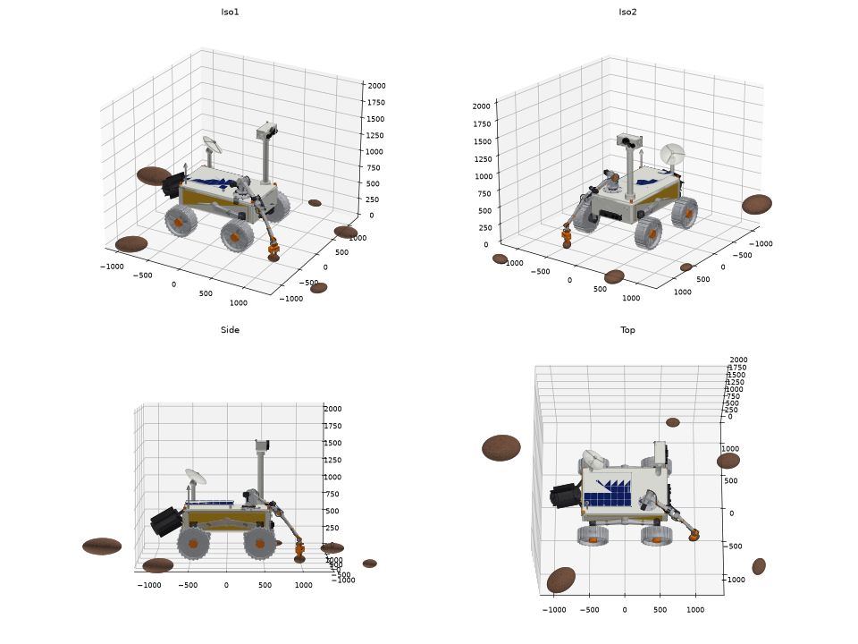
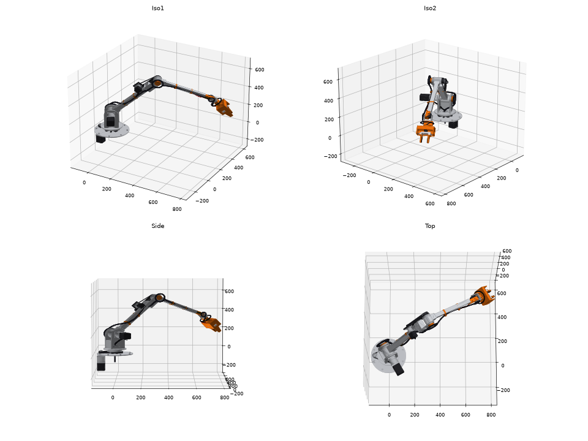
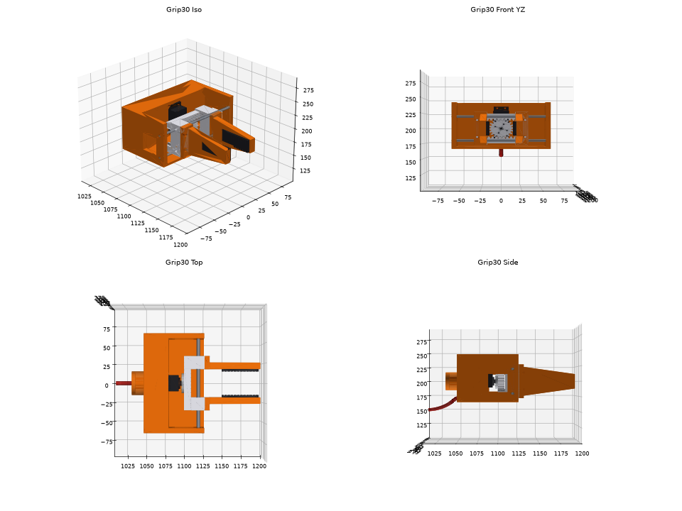
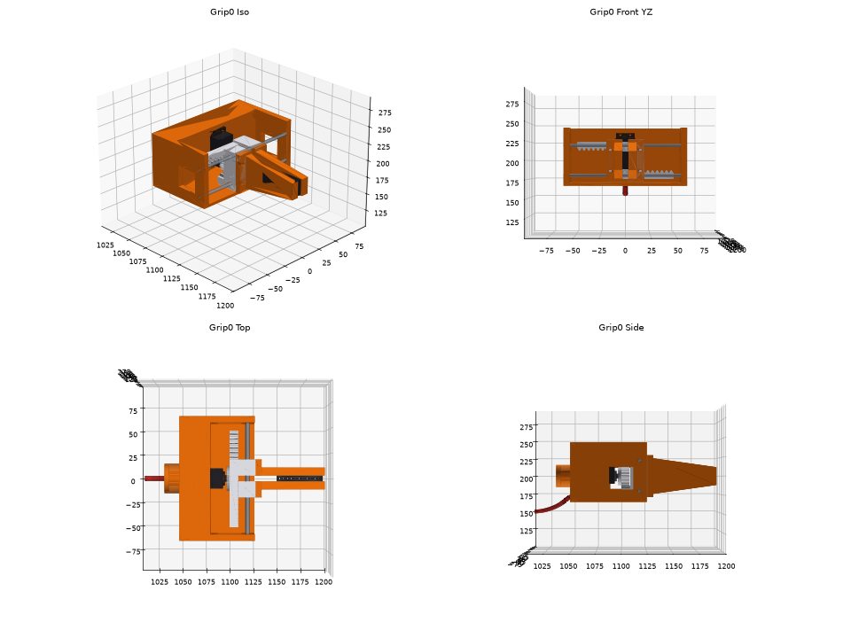

# Łazik kosmiczny „Wędrowiec-1” + 5-osiowe ramię robotyczne (FreeCAD)

Projekt CAD przygotowany jako parametryczne makra Pythona dla **FreeCAD 1.1+**, obejmujący kompletny model 4-kołowego łazika kosmicznego, w pełni funkcjonalne **5-osiowe ramię robotyczne (5-DOF)** ze wszystkimi napędami, łożyskami, enkoderami i okablowaniem oraz **równoległy chwytak zębatkowy gotowy do druku 3D**.



---

## Podgląd ramienia i chwytaka

| Ramię robotyczne 5-DOF | Chwytak otwarty (30 mm) | Chwytak zaciśnięty (0 mm) |
| :---: | :---: | :---: |
|  |  |  |

---

## Struktura repozytorium

```text
.
├── lazik_kosmiczny.FCMacro     # Pełny łazik „Wędrowiec-1” (automatycznie ładuje ramię)
├── ramie_robotyczne.FCMacro    # Samodzielny moduł 5-osiowego ramienia + eksport STL
├── STL_ramie/                  # 12 gotowych plików STL do druku 3D
│   ├── chwytak_obudowa.stl
│   ├── chwytak_zebnik_m1.5_z20.stl
│   ├── chwytak_szczeka_baza_x2.stl
│   ├── chwytak_palec_x2.stl
│   ├── chwytak_nakladka_TPU_x2.stl
│   ├── nadgarstek_obudowa_obrotu_J5.stl
│   ├── przedramie_uchwyt_serwa_J4.stl
│   ├── oslona_paska_J3.stl
│   ├── oslona_enkodera_J2.stl
│   ├── oslona_enkodera_J3.stl
│   ├── uchwyt_kabla_rura40.stl
│   └── uchwyt_kabla_rura30.stl
└── docs/
    └── images/                 # Rendery poglądowe modelu
```

---

## Wymagania

- **FreeCAD 1.1+** (testowane na `FreeCAD 1.1.4`)
- Jednostki w projekcie: **milimetry [mm]**, kąty w **stopniach [°]**.
- Układ współrzędnych łazika: `X` = przód, `Y` = lewo, `Z` = góra (`z = 0` to poziom gruntu).

---

## Jak uruchomić

### 1. W oknie graficznym FreeCAD (zalecane)

#### Sposób A — przez menedżer makr
1. Otwórz **FreeCAD**.
2. Z menu wybierz **Makro → Makra...**.
3. W polu **Lokalizacja makr użytkownika** kliknij `...` i wskaż sklonowany katalog repozytorium.
4. Wybierz:
   - `lazik_kosmiczny.FCMacro` — aby wygenerować **całego łazika** razem z terenem i ramieniem na pokładzie, lub
   - `ramie_robotyczne.FCMacro` — aby otworzyć **samo ramię** na płycie testowej i wyeksportować pliki STL.
5. Kliknij **Wykonaj**.

> **Uwaga:** oba pliki `.FCMacro` powinny znajdować się w tym samym katalogu, ponieważ `lazik_kosmiczny.FCMacro` automatycznie wczytuje `ramie_robotyczne.FCMacro` jako moduł.

#### Sposób B — szybkie otwarcie pliku
1. Wybierz **Plik → Otwórz** i wskaż `lazik_kosmiczny.FCMacro` lub `ramie_robotyczne.FCMacro`.
2. Uruchom makro zielonym przyciskiem **▶** na pasku narzędzi lub skrótem `Ctrl+F6`.

### 2. Z linii poleceń (tryb bezokienkowy `freecadcmd`)

```bash
# Samo ramię + wygenerowanie 12 plików STL w katalogu STL_ramie/
freecadcmd ramie_robotyczne.FCMacro

# Pełny model łazika
freecadcmd lazik_kosmiczny.FCMacro
```

---

## Sterowanie ramieniem i chwytakiem z Konsoli Pythona

Po uruchomieniu dowolnego z makr we FreeCAD otwórz **Widok → Panele → Konsola Pythona**. Obiekt `RAMIE` jest dostępny globalnie (w `lazik_kosmiczny.FCMacro` działa również alias `ustaw_ramie(...)`).

```python
# Przejście do predefiniowanej pozy:
# dostępne: "prezentacja", "probka", "transport", "wyprostowane"
RAMIE.poza("probka")

# Ręczne ustawienie wszystkich 6 parametrów (pominięte zachowują bieżącą wartość):
# (obrót J1, bark J2, łokieć J3, nadgarstek J4, obrót chwytaka J5, rozwarcie szczęk [mm])
RAMIE.ustaw(obrot_=20, bark=30, lokiec=60, nadgarstek=15, obrot_chw=45, rozwarcie=10)

# Zamknięcie samego chwytaka (0 mm = pełny zacisk, 70 mm = maks. rozwarcie):
RAMIE.ustaw(rozwarcie=0)

# Odczyt pozycji punktu chwytu między nakładkami TPU [mm]:
RAMIE.punkt_chwytu()

# Płynna animacja przejść między pozami (w GUI):
RAMIE.animuj()
RAMIE.zatrzymaj()
```

### Zakresy ruchu i predefiniowane pozy

| Oś / parametr | Nazwa | Zakres | `prezentacja` | `probka` | `transport` | `wyprostowane` |
| --- | --- | :---: | :---: | :---: | :---: | :---: |
| **J1** | Obrót podstawy | `-180° .. 180°` | `30.0°` | `-25.0°` | `180.0°` | `0.0°` |
| **J2** | Bark | `-40° .. 135°` | `45.0°` | `-18.0°` | `50.0°` | `75.0°` |
| **J3** | Łokieć | `-20° .. 150°` | `70.0°` | `62.0°` | `140.0°` | `15.0°` |
| **J4** | Nadgarstek (pochył) | `-90° .. 90°` | `25.0°` | `10.0°` | `-85.0°` | `-30.0°` |
| **J5** | Obrót chwytaka | `-135° .. 135°` | `0.0°` | `0.0°` | `0.0°` | `90.0°` |
| **Chwytak** | Rozwarcie szczęk | `0 .. 70 mm` | `40.0 mm` | `50.0 mm` | `0.0 mm` | `70.0 mm` |

---

## Parametry konfiguracyjne w kodzie

Na początku obu plików makr znajdują się stałe pozwalające dostosować model przed uruchomieniem:

### `lazik_kosmiczny.FCMacro`
- `POZA_RAMIENIA` — domyślna poza startowa (`"probka"`, `"transport"`, `"wyprostowane"`, `"prezentacja"`).
- `POKAZ_TEREN` (`True`/`False`) — podłoże marsjańskie i skały (jedna skała ustawia się automatycznie pod chwytakiem w pozie `"probka"`).
- `ANIMACJA` (`True`/`False`) — automatyczna pętla animacji ramienia w trybie GUI.
- `KORPUS_DL`, `KORPUS_SZ`, `KORPUS_WYS`, `PRZESWIT` — wymiary kadłuba i prześwit.
- `R_OPONY`, `SZER_KOLA`, `WYS_BIEZNIKA`, `LICZBA_BIEZNIKOW`, `ROZSTAW_X`, `KOLO_Y` — geometria i rozstaw 4 kół.
- `RAMIE_BAZA` — pozycja `(x, y)` montażu podstawy ramienia na płycie pokładu.

### `ramie_robotyczne.FCMacro`
- `POZA_STARTOWA` — domyślna poza przy uruchomieniu samodzielnym (`"prezentacja"`).
- `ANIMACJA` (`True`/`False`) — animacja po uruchomieniu w GUI.
- `EKSPORT_STL` (`True`/`False`) — automatyczny zapis części do druku do `STL_ramie/` przy uruchomieniu samodzielnym.
- `L1 = 500.0`, `L2 = 450.0`, `H_BARK = 200.0`, `L_WR = 100.0` — główne długości kinematyczne.
- `MODUL = 1.5`, `ZEBY = 20`, `LUZ = 0.10`, `T_NAKLADKI = 3.0` — parametry zazębienia ewolwentowego chwytaka i grubość nakładek TPU.

---

## Specyfikacja mechaniczna i wykaz komponentów (BOM)

### Łazik „Wędrowiec-1”
- **Kadłub:** zaokrąglona skrzynia `1200 × 700 × 300 mm` (prześwit `350 mm`) z płytą pokładu, folią izolacyjną MLI, 4 uchwytami narożnymi, przednią listwą kamer HAZCAM (4 obiektywy) i 2 reflektorami.
- **Podwozie 4×4:** zawieszenie typu rocker z wahaczami aluminiowymi, przegubami kolanowymi, osobnymi słupkami skrętu oraz silnikami skrętu i piast; 4 koła aluminiowe (`R = 210 mm`, szer. `160 mm`) z 24 żebrami bieżnika i 6 szprychami.
- **Maszt i łączność:** maszt `720 mm` z głowicą kamer stereo i głównym obiektywem, antena paraboliczna HGA na 3 zastrzałach oraz antena dookólna LGA.
- **Zasilanie:** panel słoneczny (35 ogniw w siatce `7 × 5`) i tylny generator radioizotopowy RTG z 8 żebrami chłodzącymi.

### Ramię robotyczne 5-DOF + chwytak
- **J1 (obrót podstawy):** płyta bazowa Al 8 mm (8× śruba M6), słupek drążony na 2 łożyskach `61814` (`70×90×10 mm`), silnik **NEMA 23 + przekładnia planetarna 10:1** podwieszony pod pokładem, przekładnia pasowa **HTD-5M** (`18T → 72T`, rozstaw osi `104 mm`, pas szer. `15 mm`).
- **J2 (bark):** dwie płyty Al 10 mm z kątownikami i mostkiem, **NEMA 23 + przekładnia planetarna 30:1** zamontowany współosiowo, łożysko podporowe `6005` (`25×47×12 mm`), enkoder magnetyczny **AS5600** w osłonie, ramię z profilu Al **40×40×3 mm**.
- **J3 (łokieć):** aluminiowy widelec (płyty Al 8 mm ze szczeliną do naciągu pasa), **NEMA 17 + przekładnia planetarna 14:1**, przekładnia pasowa **HTD-3M** (`16T → 48T`, pas szer. `9 mm`), dwa łożyska `6002` (`15×32×9 mm`), oś Ø15 mm, enkoder **AS5600**, przedramię z profilu Al **30×30×2 mm**.
- **J4 (pochylenie nadgarstka):** drukowany uchwyt pod serwo **DS3235** (35 kg·cm), klamra U z blachy Al 3 mm, orczyk aluminiowy 25T, sworzeń M3, łożysko podporowe `623` (`3×10×4 mm`).
- **J5 (obrót chwytaka):** drukowana obudowa pod serwo **DS3225** (25 kg·cm, 270°) + łożysko `6806` (`30×42×7 mm`).
- **Chwytak równoległy:** serwo **DS3218** (lub kompatybilne, np. MG996R), orczyk 25T, ewolwentowy zębnik `m1.5 z20` (luz międzyzębny `0.10 mm`), dwie zębatki na szczękach prowadzonych na **2 prętach stalowych Ø4 mm**, żebrowane nakładki chwytne z TPU.
- **Okablowanie:** wiązki w oplocie i przewody zasilająco-sygnałowe prowadzone przez gumowe przepusty w płytach J2, drukowane opaski na rurach 40×40 i 30×30 oraz pętle serwisowe przy osiach J2, J3, J4 i J5.

---

## Części do druku 3D (`STL_ramie/`)

Wszystkie pliki STL są wyeksportowane ze stycznością `0.02 mm` i automatycznie ułożone największą płaską ścianą do dołu (na stół drukarki).

| Plik STL | Szt. | Zalecany materiał | Opis |
| --- | :---: | --- | --- |
| `chwytak_obudowa.stl` | 1 | PETG / ASA | Obudowa chwytaka z gniazdem serwa i prowadnic Ø4 |
| `chwytak_zebnik_m1.5_z20.stl` | 1 | PETG / Nylon | Zębnik ewolwentowy `m1.5`, 20 zębów pod orczyk 25T |
| `chwytak_szczeka_baza_x2.stl` | 2 | PETG / ASA | Wózek szczęki z zębatką i otworami pod pręty Ø4 |
| `chwytak_palec_x2.stl` | 2 | PETG / ASA | Przykręcany palec chwytaka |
| `chwytak_nakladka_TPU_x2.stl` | 2 | TPU (95A) | Żebrowana nakładka antypoślizgowa na palec |
| `nadgarstek_obudowa_obrotu_J5.stl` | 1 | PETG / ASA | Obudowa serwa J5 i gniazdo łożyska `6806` |
| `przedramie_uchwyt_serwa_J4.stl` | 1 | PETG / ASA | Uchwyt serwa J4 montowany w profilu 30×30 |
| `oslona_paska_J3.stl` | 1 | Przezroczysty PETG | Osłona przekładni pasowej HTD-3M na łokciu |
| `oslona_enkodera_J2.stl` | 1 | PETG / ASA | Osłona enkodera magnetycznego AS5600 na barku |
| `oslona_enkodera_J3.stl` | 1 | PETG / ASA | Osłona enkodera magnetycznego AS5600 na łokciu |
| `uchwyt_kabla_rura40.stl` | 2 | PETG / ASA | Obejma kablowa na profil 40×40 mm |
| `uchwyt_kabla_rura30.stl` | 2 | PETG / ASA | Obejma kablowa na profil 30×30 mm |
